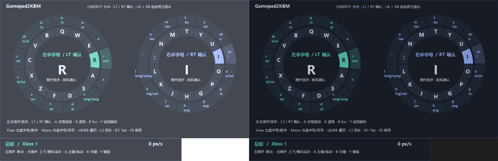

# Gamepad2KBM

Use a gamepad as a keyboard and mouse on Windows, with time-based mouse acceleration, split QWERTY typing, IME support, and vibration feedback.

用游戏手柄替代 Windows 鼠标和键盘，支持双拼输入法。适用于 Windows 10/11 x64 和 XInput 手柄，使用系统自带的 .NET Framework 编译和运行。



## 启动

下载或克隆仓库，在 Windows 中双击 `start.cmd`。程序编译到 `%LOCALAPPDATA%\Gamepad2KBM\Gamepad2KBM.exe`，启动后驻留系统托盘。

也可以直接运行 `dist\Gamepad2KBM.exe`，并将 `settings.json` 放在可执行文件旁。源码目录可以位于 WSL。

## 操作

需要辨认按键时，在 Windows 中双击 `monitor.cmd` 打开实时监听窗口。按下按钮会在手柄示意图中高亮，并显示 View / Back、Menu / Start 等名称；窗口同时显示摇杆位置、扳机数值与四个 XInput 槽位的连接状态。

1. 同时按下手柄顶部的 **LB + RB** 两个肩键，松开后在 **0.6 秒内再同时按一次**，进入鼠标模式。监听窗口显示 1/2、2/2 计数。
2. 左摇杆移动鼠标，A 左键，B 右键，右摇杆上下滚动和左右横向滚动。按住 A 配合左摇杆可以拖动。
3. 对准输入框后按 **Y**：程序在当前位置单击，进入键盘模式。将摇杆和按键松开一次后开始选字。
4. 左摇杆选择 QWERTY 左半区（`QWER / ASDF / ZXCVB`），右摇杆选择右半区（`TYUIOP / GHJKL; / NM`）；**LT 确认左环，RT 确认右环**。
5. **A** 发送空格选词，**X** 退格，**B** Esc，**LB / RB** 单独按下后松开分别 PageUp / PageDown，十字键发送方向键，**L3** 回车，**R3** Tab。
6. **Y** 返回鼠标；任意控制模式下 **LB + RB 连按两次**回到待机。键盘 **F8** 立即停用控制。托盘菜单可以退出程序。
7. 键盘模式下，单按 **View / Back** 切换左盘字母 / 数字，单按 **Menu / Start** 切换右盘字母 / 符号。LT / RT 确认对应盘的当前字符。

盖世小鸡 T4N-Pro 的肩键位于顶部，LB / RB 在 LT / RT 扳机前方。程序使用双击肩键组合，以兼容该型号的硬件快捷键。官方说明列出长按 − / ＋ 为接收器和有线模式下的模式切换功能：[GameSir Super Nova 官方说明](https://gamesir.com/support/manuals/gamesir-super-nova)。

字母按 QWERTY 键盘从左到右、从上到下分为两半，每个键出现在对应的一侧。T、G 放在右半区，左半 13 个键，右半 14 个键，覆盖全部字母和分号。摇杆推过约 45% 行程后高亮字母，按对应的 LT / RT 扳机输入一次；回到约 29% 行程以内时取消高亮。再次按下扳机可以重复输入。两个扳机同时按下时，顺序是左侧、右侧。

小鹤双拼标记随对应字母一起显示，每侧兼有声母和韵母提示，包含 `V→zh/ui/ü`、`I→ch/i`、`K→k/ing/uai` 等。标记参考[小鹤官网](https://flypy.cc/)与 [Rime 小鹤双拼键位](https://github.com/rime/rime-double-pinyin/blob/master/double_pinyin_flypy.schema.yaml)。

程序通过 Windows `SendInput` 发送物理字母键，由当前输入框的系统输入法完成双拼转换与候选词处理。使用前在目标程序中选择你常用的双拼输入法。英文输入状态下会输入英文字母。

手柄生成的键盘事件附带 AutoHotkey 的 `KEY_IGNORE` 标记，使 B 输出 Esc、L3 输出 Enter，同时保留实体键盘的 AHK 映射。

### 背键与切层

L3 是将左摇杆垂直按下，R3 是将右摇杆垂直按下。键盘模式下，L3 输出 Enter，R3 输出 Tab。

T4N-Pro 的背键支持在手柄端绑定普通按键。将左背键 L4 绑定 View / Back，右背键 R4 绑定 Menu / Start，即可在键盘模式分别短按切换左盘数字和右盘符号；再次短按恢复字母。程序通过 XInput 读取绑定后的信号，监听窗口会相应高亮 View 或 Menu，正面的这两个按键也可切层。

按[官方背键设置步骤](https://gamesir.com/support/manuals/gamesir-super-nova)：按住 M + 对应背键，直到灯条慢闪白灯；按下希望绑定的普通按键（左背键选择 View，右背键选择 Menu）；再按同一个背键保存。左右背键分别设置。

数字盘包含 `1234567890`，按数字键发送到系统输入法。符号盘包含 `.,;:!?-_/@()[]`，按标注直接输出文字。两侧独立切层；回到待机或断开手柄后恢复字母层。

清除单个背键映射：按住 M + 对应背键，灯条慢闪白灯后松开，再直接按同一个背键保存空映射。左右背键分别操作。

### 震动反馈

进入或返回鼠标模式短震 240 毫秒，进入键盘模式短震 360 毫秒，回到待机短震 120 毫秒，左右盘切层轻震 165 毫秒。震动从发出指令时开始计时，由轮询定时停止；F8 停用、断线及退出程序时立即清零。托盘菜单的“测试震动”可单独测试当前手柄，持续 360 毫秒。震动通过 XInput 输出，调用结果记录在日志中。

进入键盘后，手柄摇杆用于选字，鼠标指针保持在原处；实体鼠标仍可使用。悬浮盘使用简洁的深色面板和文字，整体不透明度为 80%，可透出后方页面。悬浮盘支持鼠标穿透，保留目标窗口的输入焦点，并跟随进入模式时鼠标所在的屏幕显示。

## 时间加速

保持相同摇杆方向和推杆幅度，也会随持续时间加速。默认参数：

| 配置 | 默认值 | 含义 |
|---|---:|---|
| `MouseDeadzone` | 0.12 | 鼠标摇杆径向死区 |
| `InitialSpeed` | 100 | 满幅推杆的初始速度，像素/秒 |
| `MaximumSpeed` | 1600 | 满幅推杆的最高速度，像素/秒 |
| `AccelerationDelay` | 0.08 | 开始加速前的低速时间，秒 |
| `FullSpeedAfter` | 0.90 | 从首次推杆到达到最高速度的总时间，秒 |
| `LetterDeadzone` | 0.45 | 字母选择所需的推杆幅度 |
| `LetterHysteresisDegrees` | 2.0 | 保持已选字母的角度余量 |

前 0.08 秒保持初始速度，随后按 Smoothstep 曲线增加，到 0.9 秒达到当前倾斜幅度对应的最高速度。实际速度乘以扣除死区并归一化后的推杆幅度的四次方，使未推满时进一步减速：归一化幅度 50% 时，最高速度为 100 像素/秒；推满时为 1600 像素/秒。加速过程中减小推杆幅度会立即减速。松手回中立即停止并清零计时；改变方向沿用本次计时。通过直接设置光标位置，使这里的速度以桌面像素计量。

从托盘打开配置，修改后退出并重新启动。断开手柄时自动返回待机并释放鼠标按键；重新连接后用组合键启用。

## 构建与验证

在 Windows PowerShell 中运行：

```powershell
.\build.ps1 -Test
.\build.ps1 -CoreOnly # 仅运行逻辑检查，适用于当前窗口正在使用时
.\build.ps1 -Run
```

在 WSL 中运行：

```bash
powershell.exe -NoProfile -ExecutionPolicy Bypass \
  -File "$(wslpath -w ./build.ps1)" -Test
```

测试覆盖时间加速、死区、微小位移累计、圆盘所有字母、边界与回中防抖、双击组合、扳机确认与输入顺序、双向滚动、按键重复和断线释放。桌面测试在临时窗口中验证真实按键、鼠标点击、像素移动和悬浮盘焦点，并恢复原窗口与鼠标位置。测试生成 `%LOCALAPPDATA%\Gamepad2KBM\keyboard-preview.png`。

实时连接诊断：

```powershell
$dir = "$env:LOCALAPPDATA\Gamepad2KBM"
Start-Process "$dir\Gamepad2KBM.exe" -ArgumentList @('--probe', "$dir\probe.json") -Wait
Get-Content "$dir\probe.json"
```

程序读取四个 XInput 槽位，使用按下激活组合键的手柄。运行日志位于可执行文件旁的 `gamepad2kbm.log`，记录连接、模式切换与输出错误。

桌面测试已验证 Windows 物理按键注入；双拼候选词及真实手柄手感由所用输入法、连接和桌面环境共同决定，需要实际试用。当前已有 Steam 或其他手柄映射时，可关闭其中的桌面键鼠映射，使 Gamepad2KBM 独立控制光标。控制普通窗口时按普通权限运行；目标窗口以管理员权限运行时，Gamepad2KBM 需要同等权限。

## 源码

- `src/Core.cs`：时间加速、双圆盘与模式状态机。
- `src/Native.cs`：XInput 读取和 Windows 鼠标、物理按键输出。
- `src/App.cs`：托盘、悬浮盘和轮询。
- `tests/Tests.cs`：行为测试与真实 Windows 桌面测试。

## 致谢与许可

交互概念受 [joytyping](https://github.com/HHHLZX/joytyping) 启发。小鹤标注参考[小鹤官网](https://flypy.cc/)与 [Rime 双拼方案](https://github.com/rime/rime-double-pinyin)，AHK 兼容标记参考 [AutoHotkey](https://github.com/AutoHotkey/AutoHotkey/blob/v2.0/source/keyboard_mouse.h)。

本项目使用 [MIT License](LICENSE)。
